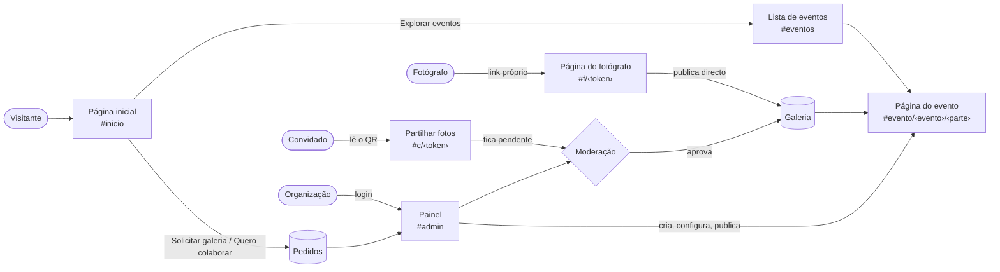
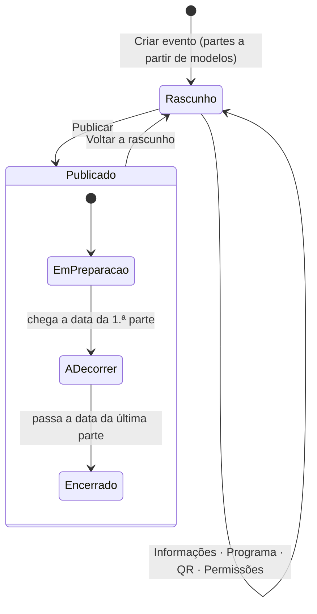
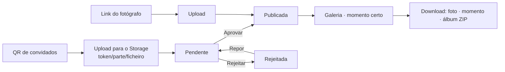

# Memória — fluxo geral da plataforma (v1.0)

> Mais do que fotos. Uma memória partilhada.

Este documento descreve **quem usa a plataforma, por onde entra e o que faz**, do primeiro
contacto até ao álbum descarregado. Cada passo indica o ecrã/rota correspondente no site.

---

## 1. Visão geral

| Perfil | Como entra | O que pode fazer | Área |
|---|---|---|---|
| **Visitante** | página inicial, link ou QR da página | ver eventos publicados, programa, galeria, vídeos, mural | pública |
| **Convidado / participante** | QR ou link de convidados (vários por evento) | tudo o que o visitante faz **+ enviar fotos** (ficam pendentes) | `#c/<token>` |
| **Fotógrafo** | link/QR próprio (um por fotógrafo) | publicar directamente, descarregar o álbum | `#f/<token>` |
| **Organização** | email + palavra-passe (Supabase Auth) | tudo: criar, configurar, moderar, publicar, ver estatísticas | `#admin` |

As quatro áreas estão **separadas**: cada uma tem o seu cabeçalho e não há ligação do lado do
convidado ou do fotógrafo para o painel.

---

## 2. Perfil Convidado / Participante — "uma experiência simples, intuitiva e envolvente"

| # | Passo | O que acontece | Ecrã / rota |
|---|---|---|---|
| 1 | **Acesso ao sistema** | Entra por um link ou QR Code. Na página inicial: "Explorar eventos". | `#inicio` |
| 2 | **Explorar eventos** | Lista de eventos com pesquisa e filtros por categoria. | `#eventos` |
| 3 | **Detalhes do evento** | Capa, nome, data, local; separadores Sobre · Programa · Galeria · Vídeo. | `#evento/<evento>` |
| 4 | **Programa do dia** | Agenda com horários; o momento a decorrer tem o selo "Em curso". | separador Programa |
| 5 | **Galeria e vídeos** | Fotografias por momento; filtros Todos · Oficiais · Convidados; vídeos e directos. | separadores Galeria / Vídeo |
| 6 | **Partilhar fotos** | Escolhe as fotos (ou arrasta), indica a origem — **Fotógrafo · MC · Convidado** —, o nome e o momento. Envio fica **pendente**. | `#c/<token>` |
| 7 | **QR Code** | "Contribua com as suas fotos": QR para outros convidados lerem com a câmara. | página do evento |
| 8 | **Localização e contacto** | Mapa, nome do local, telefone e email da organização. | página do evento |

Funcionalidades: programa do evento · galeria e vídeos · envio de fotografias (com origem) ·
QR Code · localização e contacto · partilha do evento.

---

## 3. Perfil Fotógrafo

1. Recebe da organização **o seu** link/QR (`#f/<token>`), limitado às partes do evento que vai cobrir.
2. Escolhe a parte (ex.: lobolo) e o momento, carrega a sessão.
3. As fotos **entram directamente** na galeria, assinadas com o nome do estúdio.
4. Descarrega o álbum (ZIP, organizado por momento).

---

## 4. Perfil Administrador / Organizador — "controlo total sobre o evento e o seu conteúdo"

| # | Passo | O que acontece | Onde |
|---|---|---|---|
| 1 | **Painel de controlo** | Visão geral: eventos, visualizações, contribuições, por aprovar; gráfico dos últimos 14 dias; próximos eventos. | `#admin` (Dashboard) |
| 2 | **Criar ou editar evento** | Nome, categoria, partes (lobolo, casamento…) a partir de modelos, datas. Depois: capa, "Sobre o evento", local, mapa, telefone, email. | `#admin/novo` → evento › **Informações** |
| 3 | **Gerar QR Code** | QR de contribuições dos convidados (activo/fechado), descarregar PNG, copiar link, **Permitir envios**; QR extra por grupo/mesa; escolher o QR mostrado na página. | evento › **QR Code** |
| 4 | **Gerir contribuições** | Pendentes · Aprovadas · Rejeitadas (com contagens); aprovar, rejeitar, repor, mudar de momento, aprovar todas; mensagens do mural. | evento › **Contribuições** e `#admin/contribuicoes` |
| 5 | **Gerir vídeos** | Carregar vídeo oficial, juntar transmissão em directo (YouTube, Facebook…) ou link; editar, marcar como oficial, eliminar. | evento › **Vídeos** e `#admin/videos` |
| 6 | **Acompanhar actividade** | Visualizações e contribuições por dia, quem mais contribuiu, desempenho de cada QR. | evento › **Actividade** |
| 7 | **Configurar permissões** | Permitir envio de fotos · Mostrar vídeo · Galeria pública. | evento › **Permissões** |
| 8 | **Publicar e partilhar** | Lista de verificação → **Publicar evento** → "Evento publicado com sucesso!", ver evento, copiar link, QR da página. Pode voltar a rascunho. | evento › **Publicar** |

Também no painel: **Programa** (editar momentos e missões), **Fotógrafos** (páginas por
fotógrafo), **Álbum** (downloads ZIP), **Avançado** (datas, tema, apagar), **Galerias**,
**Pedidos** (vindos da página inicial) e **Definições**.

---

## 5. Ciclo de vida de um evento

- **Rascunho:** só a organização vê. Os QR **já funcionam** — dá para receber fotos antes do dia.
- **Publicado:** visível para quem tiver o link; aparece na lista de eventos.
- **No dia:** a organização marca o momento "a acontecer agora"; os convidados enviam, a organização aprova.
- **Depois:** fechar envios (Permissões), descarregar o álbum, manter a galeria pública ou não.

## 6. Ciclo de vida de uma fotografia

Cada fotografia guarda: evento, parte, **momento do programa**, missão (se houver), **por que QR
chegou**, **origem declarada** (fotógrafo · MC · convidado), autor e estado.

---

## 7. Dados e segurança (Supabase)

- **Catálogo:** categorias → tipos de evento → modelos de programa (momentos + missões) → temas.
- **Evento:** eventos → partes → momentos · missões · mural · ficheiros · vídeos · visitas;
  acessos (QR/links) → partes permitidas.
- **Regras:** o público só lê eventos publicados e o que foi aprovado; convidados e fotógrafos
  não fazem login — o token do QR é validado no servidor (`acesso_info`, `registar_envio`);
  ficheiros num bucket privado com URLs assinados; a organização faz tudo.
- Instalação e detalhe: [`supabase/LEIA-ME.md`](supabase/LEIA-ME.md).

---

## 8. Estado actual

| Parte | Estado |
|---|---|
| Página inicial (mobile), pedidos | feito |
| Painel do administrador (passos 1–8) | feito |
| Partilhar fotos com origem (convidado, passo 6), página do fotógrafo | feito |
| Lista de eventos e página do evento (convidado, passos 2–3) | feito (lista, página, partilha, visualizador) |
| Separadores Sobre · Programa · Galeria · Vídeo; Programa do dia; Galeria e vídeos; QR; Localização (convidado, 3–5, 7–8) | feito — ecrãs prontos; ganham conteúdo à medida que a organização preenche o evento no painel |
| Versão de computador da página inicial | por fazer |
| Domínio e alojamento (Vercel) | por fazer |
